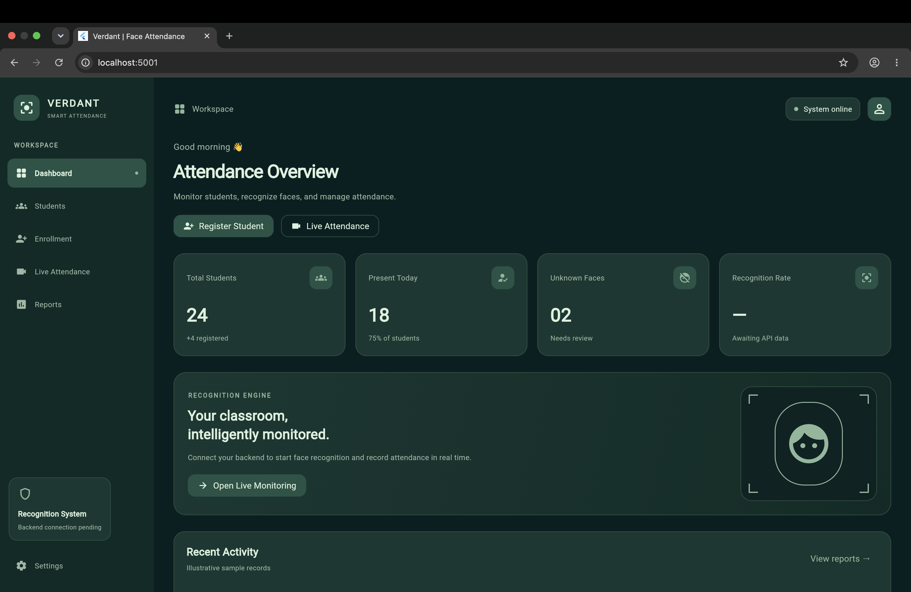
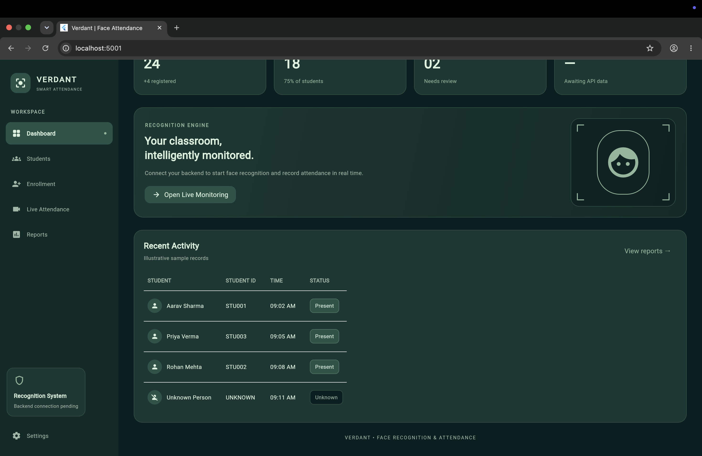
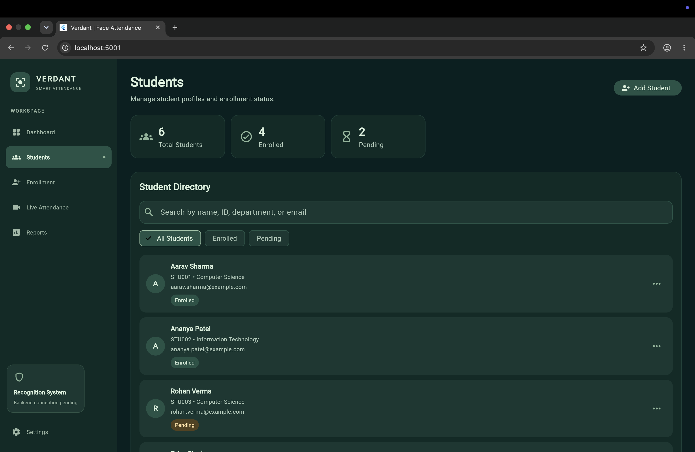
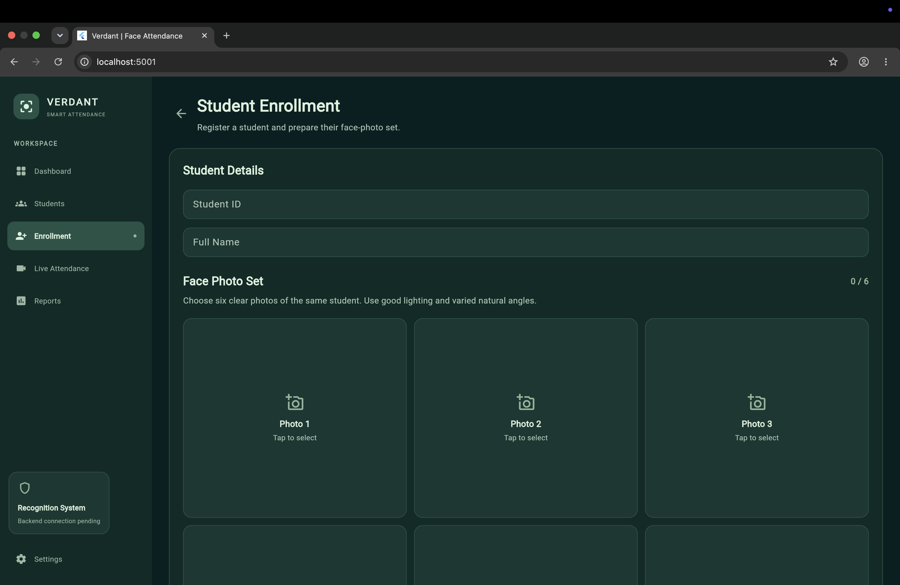
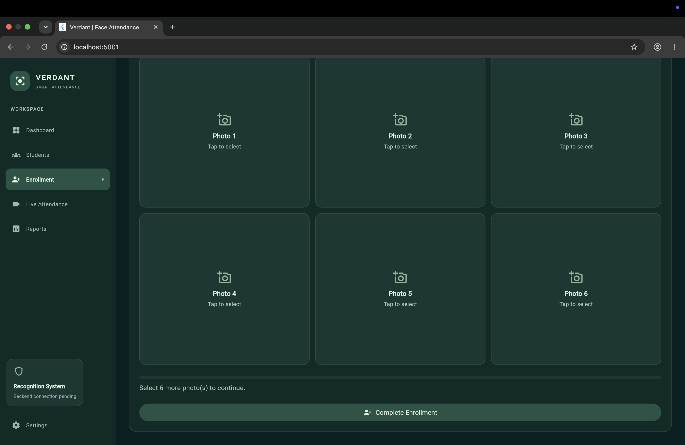
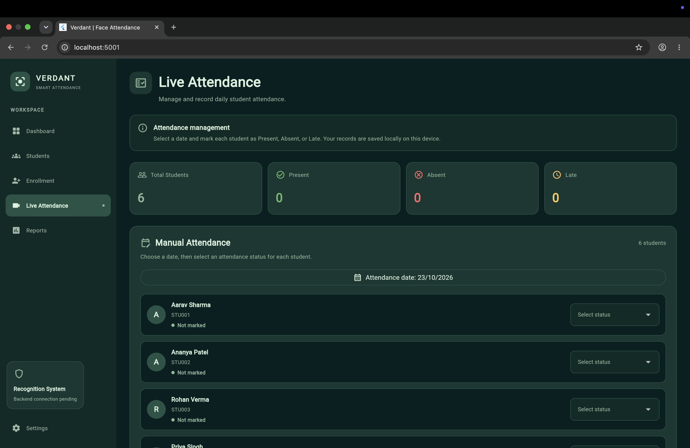
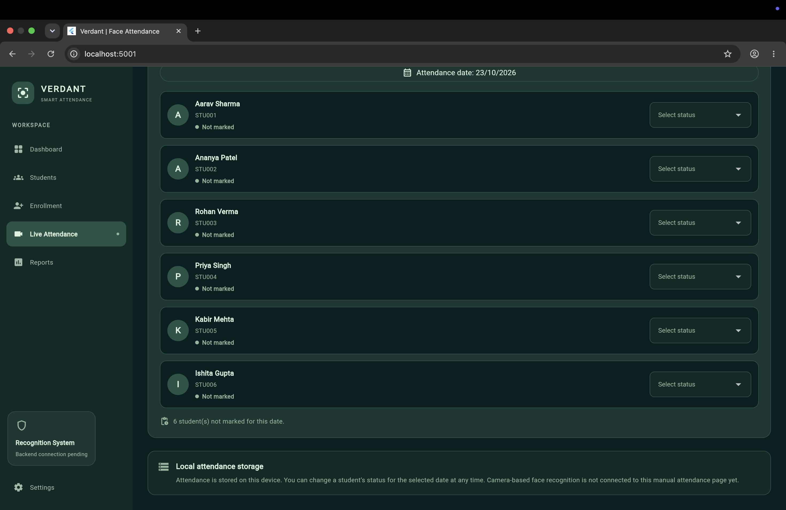
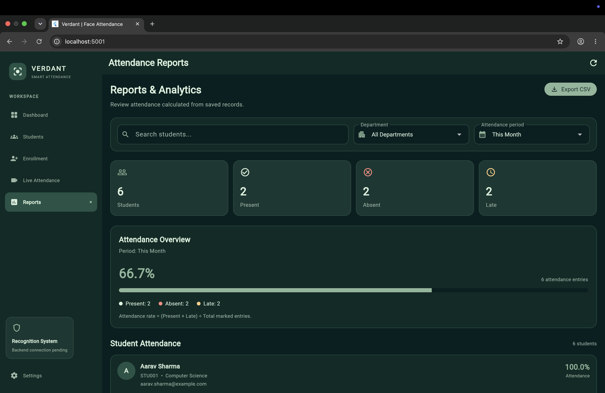
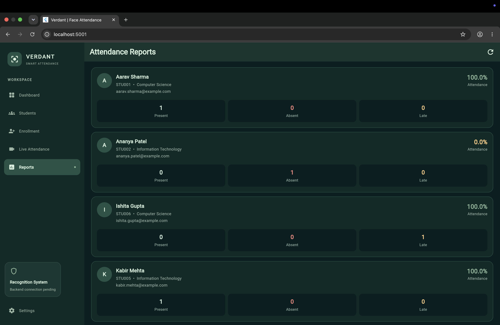
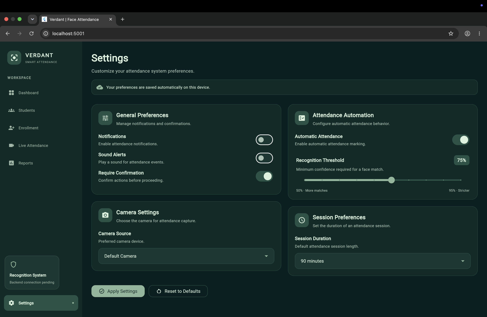

# Verdant — Attendance Management System

A Flutter-based student attendance management application featuring a forest-green interface, student enrollment, attendance tracking, and report generation.

## Overview

Verdant is designed to simplify student attendance management through a clean, intuitive interface. The current version focuses on the frontend and local data persistence, with face-recognition backend integration planned for a future phase.

## Features

- **Student Management** — Enroll and manage student records.
- **Attendance Tracking** — Mark students present, absent, or late.
- **Attendance Reports** — View attendance summaries and filter records by date period, department, and search query.
- **CSV Export** — Export filtered attendance reports.
- **Local Persistence** — Retain student and attendance records using Shared Preferences.
- **Consistent UI** — Dark forest-green and sage-green theme.
- **Cross-platform Foundation** — Flutter project configured for supported platforms.

## Screenshots

### Dashboard



### Student Enrollment




### Live Attendance



### Attendance Reports



### settings



## Tech Stack

- **Framework:** Flutter
- **Language:** Dart
- **Local Storage:** Shared Preferences
- **Version Control:** Git and GitHub

## Getting Started

### Prerequisites

- Flutter SDK
- Dart SDK (included with Flutter)
- Google Chrome, for running the web version

### Installation

1. Clone the repository:

   ```bash
   git clone https://github.com/sonakshibadgurjar/verdant-attendance-system.git
   ```

2. Open the project directory:

   ```bash
   cd verdant-attendance-system
   ```

3. Install dependencies:

   ```bash
   flutter pub get
   ```

4. Run the application in Chrome:

   ```bash
   flutter run -d chrome
   ```

## Backend Status

The current implementation uses local persistence for student and attendance records. Integration with the separate face-recognition backend is pending.

The planned recognition pipeline is:

Image Input → Face Detection → Landmark Detection → Face Alignment → Face Embedding → Similarity Matching → Match/Unknown Result

## Future Improvements

- Integrate the face-recognition backend through APIs.
- Connect live camera capture to recognition results.
- Synchronize attendance records with a backend database.
- Add authentication and role-based access.
- Improve deployment and automated testing.

## Author

**Sonakshi Badgurjar**

- GitHub: [@sonakshibadgurjar](https://github.com/sonakshibadgurjar)
- LinkedIn: [Connect on LinkedIn](https://www.linkedin.com/in/sonakshi-badgurjar-45a551382/)

---

*Built with Flutter and Dart.*


